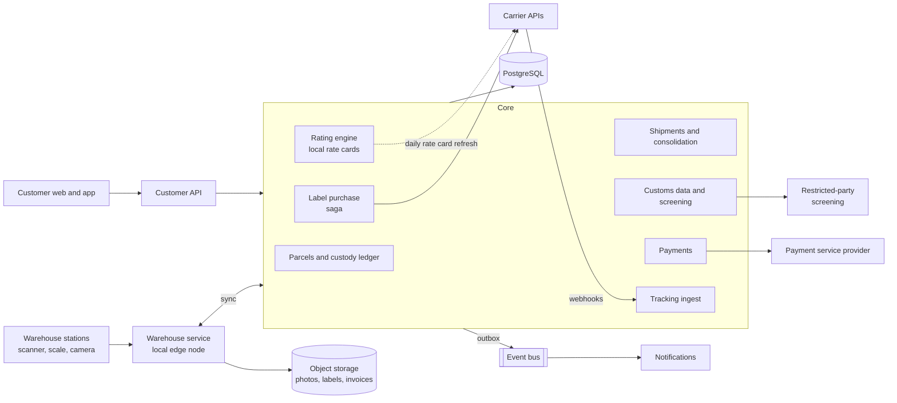
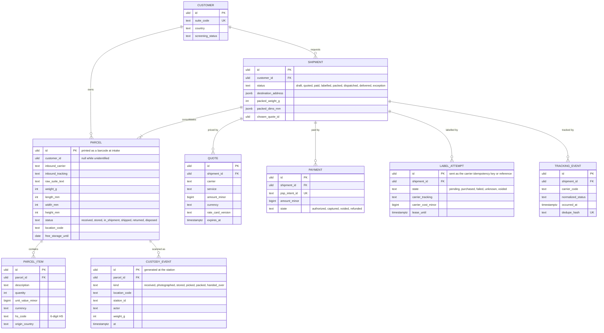
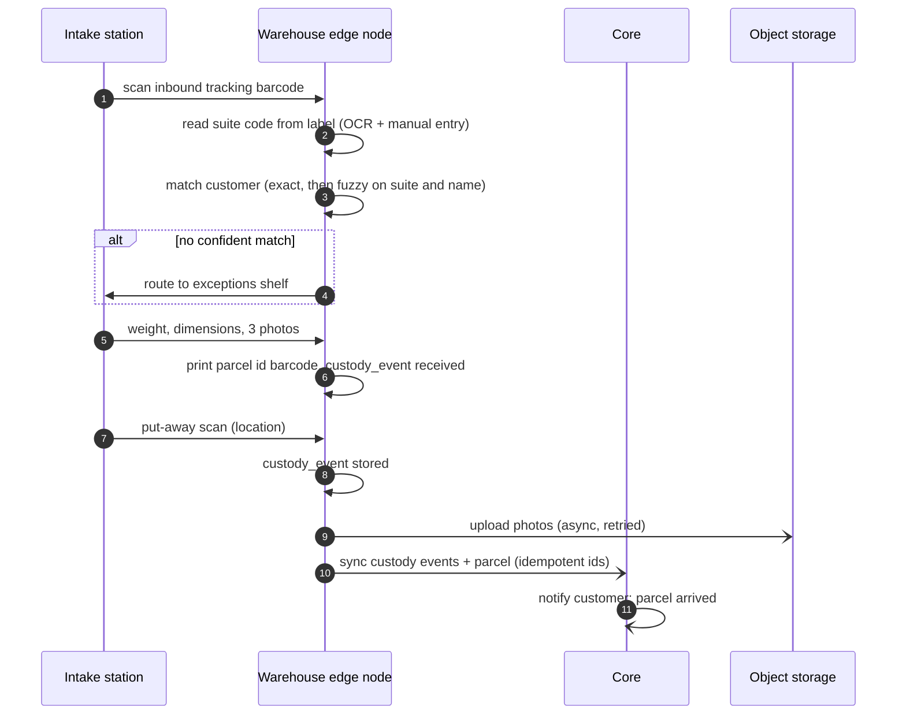
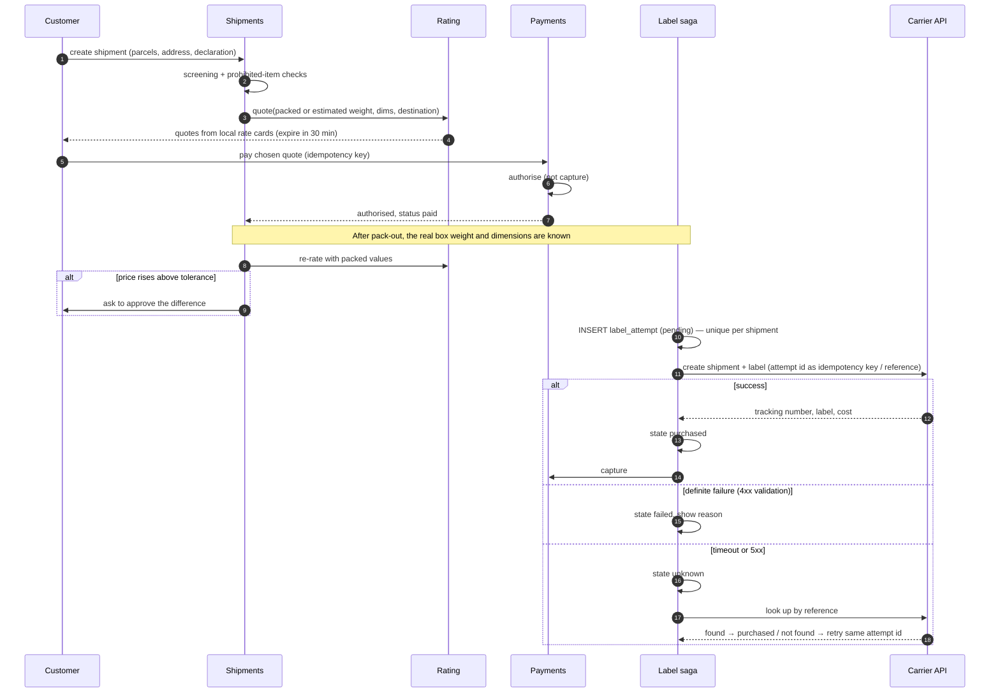

# International package forwarding

A service that gives shoppers abroad a domestic warehouse address. They buy from domestic retailers that don't ship
internationally, the parcels arrive at the warehouse, and the service consolidates them, shops carrier rates,
prepares customs data, takes payment, buys the label and ships. Every physical step is a scan, and every paid
step is idempotent.

> **Related code:** none. This is a generic design drawn from the problem space, not from any product.

## Contents

- [Problem and requirements](#problem-and-requirements)
- [Capacity estimates](#capacity-estimates)
- [High-level architecture](#high-level-architecture)
- [Data model](#data-model)
- [Key flows](#key-flows)
- [Customs and export data](#customs-and-export-data)
- [Scaling and bottlenecks](#scaling-and-bottlenecks)
- [Failure modes](#failure-modes)
- [Consistency and idempotency](#consistency-and-idempotency)
- [Security and compliance](#security-and-compliance)
- [Observability](#observability)
- [Trade-offs considered and rejected](#trade-offs-considered-and-rejected)
- [ADRs](#adrs)

## Problem and requirements

A customer in another country signs up and gets an address like `123 Warehouse Rd, Suite AB1234, City, ST`. They shop
at domestic online stores using that address. Parcels arrive from many inbound carriers, often with a mangled suite
number. The customer sees each parcel in their account (with photos), chooses which ones to ship together, declares
the contents, picks a carrier service from live quotes, pays, and receives tracking until delivery.

### Functional requirements

1. **Intake:** scan the inbound tracking barcode, identify the customer from the suite code, weigh, measure,
   photograph, put away to a storage location. Unidentifiable parcels go to an exception queue.
2. **Storage:** free for a set period (e.g. 30 days), then storage fees. Customers can request extra services:
   photos of contents, repack, remove retail boxes, add insurance.
3. **Consolidation:** combine several parcels into one shipment and box, which cuts dimensional weight and per-parcel fees.
4. **Customs declaration:** per item description, quantity, value, currency, country of origin and HS code.
   Commercial invoice generation, and electronic data to the carrier.
5. **Rate shopping:** quotes across several carriers and services (express, economy, postal) for the actual or
   estimated consolidated weight and dimensions, including duties and taxes where the service is duties-paid.
6. **Payment:** card and wallet payments in several currencies, refunds and partial refunds, saved methods.
7. **Label purchase and dispatch:** buy the label, print it, pack, hand over to the carrier on a scheduled pickup.
8. **Tracking:** ingest carrier tracking events (webhooks, with polling as a fallback), normalise them, notify the customer.
9. **Claims:** lost or damaged parcels, with evidence (photos, scans, weights).

### Non-functional requirements

| Requirement | Target | Why |
|---|---|---|
| Inbound volume | 20,000 parcels/day, 3× during the November–December peak | A mid-sized forwarder |
| Intake throughput | Every parcel received on a given day is visible to its customer the same day | Customers watch for their parcels |
| Quote latency | p95 ≤ 1.5 s for a full multi-carrier quote | Checkout conversion |
| Label purchase | Never pay a carrier twice for one shipment; never ship without payment | Each mistake is real money |
| Availability | 99.9% for customer-facing web and API; warehouse floor can't stop for a cloud outage | Warehouse staff are paid by the hour |
| Tracking freshness | Customer sees a carrier event within 5 min of receiving it | |
| Custody evidence | Every scan of every parcel kept ≥ 1 year (longer for claims in progress) | Claims and disputes |

## Capacity estimates

**Warehouse floor.**

- 20,000 parcels/day normal, 60,000/day at peak. With two 8-hour intake shifts at peak: 60,000 / 16 h = 3,750/h,
  about **1 parcel/s** across the floor.
- One intake station processes a parcel in about 30 s (scan, weigh, measure, three photos, label, put away),
  so 120/h. At peak that's 3,750 / 120 ≈ **32 stations** staffed. This is a staffing problem as much as a software one.
- Photos: 3 × 500 KB = 1.5 MB per parcel, so **30 GB/day** normal, 90 GB/day at peak. About 13 TB a year.
  Keep them hot for 90 days, then in infrequent-access storage for the rest of the year.

**Outbound shipments.**

- If customers consolidate 3 parcels per shipment on average: 20,000 / 3 ≈ **6,700 shipments/day**, about
  20,000/day at peak. That's also the number of labels and payments per day.
- Pack-out happens in shifts, so labels are bought in bursts. 20,000 labels in a 12-hour packing day is
  0.5/s on average, with bursts of a few per second.

**Rate shopping.**

- Customers request quotes several times while deciding: assume 5 quote requests per shipment, so
  6,700 × 5 ≈ 33,000 quote requests/day, and 100,000 at peak.
- Each quote covers 4 carriers. If every quote called every carrier's API, that's 400,000 carrier calls/day at peak.
  Carrier rate APIs are often 1–3 s per call and rate-limited.
- So quotes are **computed locally from rate cards** (published or negotiated rate tables, fuel surcharges and zone
  charts, refreshed daily), and checked against the live API only at purchase. Only about 20,000 live rate calls/day
  remain, all on the purchase path. See [ADR-0002](adr/0002-quotes-from-local-rate-cards-live-rate-at-purchase.md).

**Tracking.**

- At peak, 20,000 shipments/day × about 10 days in transit ≈ **200,000 shipments in flight**.
- About 15 events per shipment: 20,000 × 15 ≈ **300,000 events/day** at peak, about 3.5/s on average. Carriers send
  webhooks in bursts, so design for **100 events/s** of ingestion.
- Shipments whose carrier sends no webhooks are polled. 200,000 in flight polled every 4 hours is about 14 calls/s,
  which is the reason to prefer webhooks and to poll adaptively (more often near expected delivery).

**Database.** Parcels, shipments, scans and tracking events add up to a few million rows a day at peak:
for example 60,000 parcels × 8 scans = 480,000 custody events, plus 300,000 tracking events. At about 300 bytes a row,
that's well under 1 GB/day. One PostgreSQL primary with replicas is enough. Partition custody and tracking events by month.

## High-level architecture

| Component | Responsibility | Notes |
|---|---|---|
| Warehouse service (edge) | Station workflows: scan, weigh, photograph, put away, pick, pack, print. Runs on a local node in the warehouse | Keeps the floor working through internet or cloud outages; syncs custody events with idempotent ids |
| Parcels and custody ledger | Parcel identity, customer matching, storage, and an append-only log of every physical scan | See [ADR-0003](adr/0003-append-only-custody-ledger-for-physical-parcels.md) |
| Shipments and consolidation | Groups parcels into a shipment, tracks the pack-out, records final box weight and dimensions | |
| Customs data and screening | Item lines with HS codes, values and origin, commercial invoice, export filing triggers, restricted-party and prohibited-item checks | |
| Rating engine | Quotes from local rate cards (zones, weight breaks, dimensional weight, surcharges), duties and tax estimates | |
| Payments | Authorise, capture, refund through a PSP. Stores PSP ids only, never card data | |
| Label purchase | The saga that turns a paid shipment into exactly one valid label | See [ADR-0001](adr/0001-idempotent-label-purchase-saga.md) |
| Tracking ingest | Verifies and de-duplicates carrier webhooks, normalises codes, polls carriers without webhooks | |

## Data model

Constraints that carry the guarantees:

- A **partial unique index** allows at most one `label_attempt` per shipment in state `pending`, `purchased` or
  `unknown`. A second purchase can't even start while one is live or unresolved.
- `payment.psp_intent_id` unique, and every PSP call carries an idempotency key derived from the payment id.
- `custody_event.id` is generated at the station, so the edge node can re-sync without duplicates.
- `tracking_event.dedupe_hash` (carrier, tracking number, carrier event code, occurred_at) unique: webhook
  redeliveries are no-ops.
- A parcel can belong to at most one non-cancelled shipment (`parcel.status = in_shipment` with a conditional update).

## Key flows

### Intake

### Checkout and label purchase

### Tracking webhooks

Carriers post events to a per-carrier endpoint. Each request's signature is verified (or the source is checked
when a carrier doesn't sign). The raw body goes to object storage and the event onto a queue, and the endpoint
answers `200` immediately. Consumers normalise the carrier's event code to a small status set
(`in_transit`, `customs_hold`, `out_for_delivery`, `delivered`, `exception`, `returned`) and insert with the dedupe hash.
The shipment's status only moves forward by a precedence order, because events arrive out of order.
A late "in transit" scan can't move a delivered shipment back to in transit. The event is stored anyway.

## Customs and export data

Customs data is the part of this domain most often done badly, and it's where shipments get held.

- **Item-level declarations.** Each parcel's contents are declared as item lines: description, quantity, unit value,
  currency, country of origin and a 6-digit HS code. A shipment's commercial invoice is the union of its parcels' lines.
- **Getting HS codes right.** Customers don't know HS codes. The system suggests one from the description and retailer
  (a classifier, or an LLM constrained to the HS nomenclature, with the code validated against the official list),
  and the customer confirms. Descriptions like "gift" or "clothes" are rejected as too vague.
- **Value integrity.** Under-declaring value to avoid duties is the main fraud. Declared values are compared to the
  retailer invoice when the customer forwards it, and outliers per item type are flagged for review.
- **Destination rules.** Duty and tax thresholds (de minimis) and documentation requirements vary by country and
  change. They're data in the rating engine, with effective dates. Many destinations now require advance electronic
  data before goods are loaded (the EU's ICS2 is one example), so the declaration must be structured and complete
  at label time, not just printed on paper.
- **Export controls** (US example; not legal advice): screen the recipient against the government's consolidated
  restricted-party lists; check items against prohibited and controlled categories; file electronic export information
  when a commodity line exceeds the reporting threshold (currently $2,500 per Schedule B line) or a licence is required.
  The filing's reference number goes on the shipment record.
- **Dangerous goods.** Lithium batteries, perfume (flammable), aerosols and nail polish are restricted by air.
  Intake staff flag them from the photos and the retailer, and services that can't carry them are removed from quotes.

## Scaling and bottlenecks

1. **People and stations at peak.** About 32 intake stations at peak is the real ceiling, so software keeps the
   per-parcel time down: one scan identifies the customer in most cases, photos upload asynchronously, and the
   station never waits on the cloud.
2. **Carrier APIs.** Slow, rate-limited and sometimes down, especially in December. Local rate cards take quotes off
   them entirely. Label purchases use per-carrier concurrency limits and circuit breakers, and a backlog is held in
   the label queue rather than failing packers' requests.
3. **Unidentified parcels.** At 2% of 60,000/day, that's 1,200 a day that need a human. Matching quality (fuzzy suite
   matching, retailer order emails, customer pre-alerts with inbound tracking numbers) directly cuts headcount.
4. **Tracking volume** is modest (about 100 events/s at most). Polling is the cost to watch; poll adaptively.
5. **Database** is not a bottleneck at these volumes. A second warehouse or country is a new edge node and the same
   core, with a `warehouse_id` on parcels and shipments from day one.

## Failure modes

| Failure | Detection | Handling |
|---|---|---|
| Internet or cloud outage in the warehouse | Edge node sync lag | Edge node keeps intake, put-away, pick and pack working. Events sync later by idempotent id. Label purchase needs the carrier and waits; packed boxes are staged |
| Label purchase times out | Request timeout | Attempt goes to `unknown`. Reconcile by carrier reference before any retry. Never start a new attempt while one is unknown |
| Two labels bought anyway (carrier ignored the reference) | Nightly reconciliation of carrier invoices against labels | Void the unused label within the carrier's void window; alert if any label is billed without a matching shipment |
| Payment authorised, label never bought | Authorisations older than N hours without a label | Void the authorisation (before it expires) and tell the customer |
| Packed weight differs from quote | Re-rate after pack-out | Absorb within tolerance; otherwise ask the customer to approve the difference before buying the label |
| Carrier rejects the declaration | 4xx with validation errors | Label attempt `failed` with the reason; shipment goes back to the customer to fix |
| Webhooks lost or carrier stops sending | No event for a shipment longer than its service's usual gap | Fall back to polling for that shipment |
| Parcel can't be found at pick time | Pick scan missing | Custody ledger shows the last scan and location. Cycle count of that location; claim flow if it stays missing |
| Customs hold at destination | `customs_hold` events | Notify the customer with the carrier's requirement; the declaration and invoice are on file to resend |
| PSP outage | Error rate | Checkout fails clearly ("try again shortly"); nothing is bought without an authorisation |

## Consistency and idempotency

- **The label saga** is the core of this design ([ADR-0001](adr/0001-idempotent-label-purchase-saga.md)):
  authorise → buy label (idempotent by attempt id, reconciled by reference) → capture, with compensations:
  void the authorisation if no label, void the label if capture fails.
- **Payments** use the PSP's idempotency keys on every mutating call. Webhooks from the PSP are de-duplicated by event id.
- **Custody events** are immutable and idempotent by station-generated id. Parcel location and status are derived
  from the latest event, so the edge node and core converge.
- **Tracking** is at-least-once, de-duplicated by hash, with monotonic status precedence.
- **Quotes** are immutable and expire. Paying references a quote id, so the price charged is the price shown.
  A re-rate after pack-out creates a new quote, never edits the old one.

## Security and compliance

- **Payment data:** card data never touches our systems. The PSP's hosted fields or SDK tokenise it, which keeps the
  PCI DSS scope to the smallest self-assessment level. 3-D Secure (SCA) where the card's region requires it.
- **Personal data:** names, addresses, phone numbers and purchase history under GDPR and other privacy laws in
  customers' countries. Photos of parcel *contents* can be sensitive (medication, for example), so they're shown only
  to the owner and staff with a reason, and retained on a schedule.
- **Fraud:** stolen cards used to buy goods shipped through the forwarder, and reshipping scams. Signals: new
  account, high-value electronics, mismatched billing and destination countries, retailer-flagged orders. Hold
  high-risk shipments for review before label purchase; capturing payment only after labelling limits exposure.
- **Export compliance:** restricted-party screening on every recipient and on changes to addresses, prohibited-item
  checks, export filing where required, and records kept for the legally required period (5 years for US export records).
- **Carrier credentials** live in a secrets manager, per carrier account. Webhook endpoints verify signatures or use
  secret URL tokens rotated regularly.
- **Warehouse:** staff accounts per person (no shared logins at stations), so every custody event has a named actor.

## Observability

| SLI / signal | Target or alert |
|---|---|
| Parcel received → visible to customer | p95 ≤ 2 h; alert when the edge sync lag exceeds 15 min |
| Unidentified parcel rate | Alert above 3% for a day |
| Quote latency and quote error rate | p95 ≤ 1.5 s |
| Quote vs final price difference | Distribution per carrier; drift means stale rate cards |
| Label attempts in `unknown` | Any older than 15 min alerts |
| Authorisations without labels after 24 h | Alert (money held on customers' cards) |
| Carrier invoice vs labels reconciliation | Daily; unmatched charges must be zero |
| Webhook ingestion lag and signature failures | Lag ≤ 5 min; any signature failure spike alerts |
| Customs holds and rejections per destination | Trend; spikes point to a rule change at a destination |
| Storage nearing free-period end | Customer notifications sent; this is also revenue |

## Trade-offs considered and rejected

| Option | Why not, for these requirements |
|---|---|
| **Live carrier rate calls for every quote** | 400,000 calls/day at peak, 1–3 s each, rate-limited. Local rate cards are faster and only need a check at purchase. See [ADR-0002](adr/0002-quotes-from-local-rate-cards-live-rate-at-purchase.md) |
| **A multi-carrier aggregator API only** | Faster to start and a sensible early choice, but its margin and outages become yours, and negotiated rates may not be supported. Keep the label saga carrier-agnostic so an aggregator can be one "carrier" among several |
| **Capture payment at checkout** | Simpler, but the final weight isn't known until pack-out, and refunds cost fees and trust. Authorise, then capture after the label |
| **Cloud-only warehouse system** | A WAN outage would stop a floor of 30+ staff. The edge node costs a small server and a sync protocol |
| **Mutable parcel location field only** | Can't answer "where was it and who touched it" in a claim. See [ADR-0003](adr/0003-append-only-custody-ledger-for-physical-parcels.md) |
| **Free-text customs descriptions** | Get shipments held, and won't meet advance-data requirements. Structured lines with HS codes, validated |

## ADRs

- [ADR-0001: Idempotent label purchase as a saga with reconciliation by carrier reference](adr/0001-idempotent-label-purchase-saga.md)
- [ADR-0002: Quotes from local rate cards; live rate only at purchase](adr/0002-quotes-from-local-rate-cards-live-rate-at-purchase.md)
- [ADR-0003: An append-only custody ledger for physical parcels](adr/0003-append-only-custody-ledger-for-physical-parcels.md)
