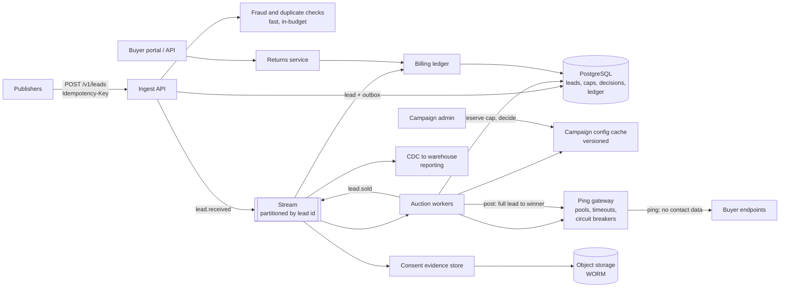
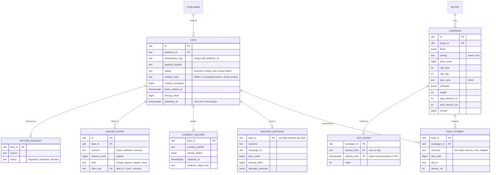
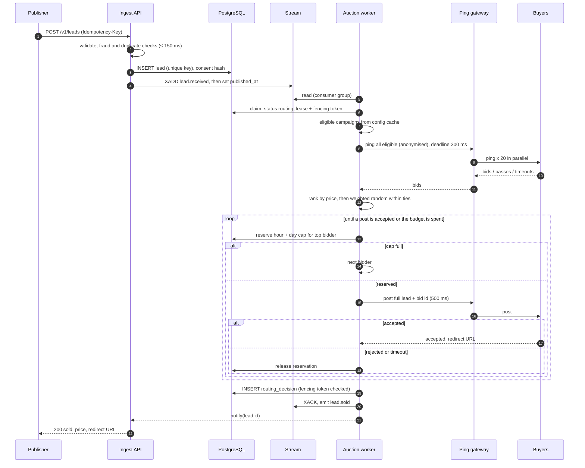
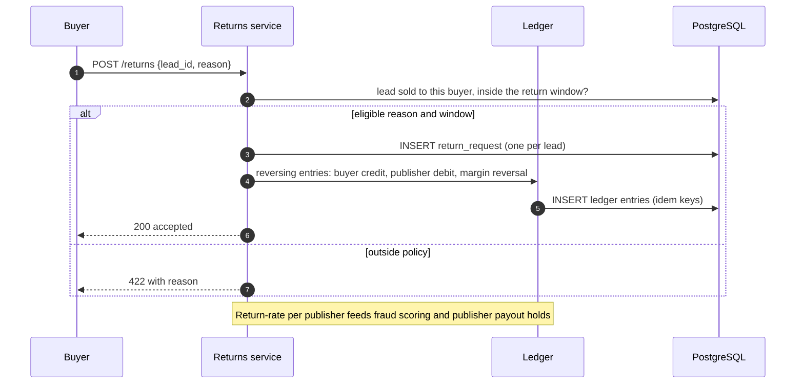

# Lead distribution: a real-time ping-post marketplace

A marketplace that buys consumer enquiries (leads) from publishers and sells each one, within about two seconds,
to the buyer that pays the most for it. It never sells a lead twice, never exceeds a buyer's cap, and keeps
evidence of the consumer's consent for years.

> **Related code:** [adilKhan72/lead-routing-engine](https://github.com/adilKhan72/lead-routing-engine) implements
> the routing core of this design: idempotent ingest with an outbox, Redis Streams consumer groups, claim leases
> with fencing tokens, cap reservations as conditional upserts in PostgreSQL, sequential ping-post with timeouts,
> and dead-lettering. This write-up covers the marketplace around that core: parallel auctions, billing and
> returns, consent evidence, fraud and duplicate checks, and buyer-local caps.
> [What the repo covers vs this design](#what-the-repo-covers-vs-this-design) lists the differences.

## Contents

- [Problem and requirements](#problem-and-requirements)
- [Capacity estimates](#capacity-estimates)
- [High-level architecture](#high-level-architecture)
- [Data model](#data-model)
- [Key flows](#key-flows)
- [Scaling and bottlenecks](#scaling-and-bottlenecks)
- [Failure modes](#failure-modes)
- [Consistency and idempotency](#consistency-and-idempotency)
- [Security and compliance](#security-and-compliance)
- [Observability](#observability)
- [Trade-offs considered and rejected](#trade-offs-considered-and-rejected)
- [ADRs](#adrs)
- [What the repo covers vs this design](#what-the-repo-covers-vs-this-design)

## Problem and requirements

Publishers (comparison sites, affiliates, call centres) collect enquiries such as "I want a $15,000 personal loan"
or "quote me car insurance". The marketplace sells each lead to one buyer (a lender, an insurer, an agency).
A lead contacted within a minute converts several times better than one contacted an hour later, so the sale
happens in real time while the consumer is still on the publisher's page. The publisher often shows the
winning buyer's offer or redirect URL on its thank-you page.

**Ping-post** is the industry pattern. The marketplace *pings* candidate buyers with an anonymised lead (state,
amount, credit band, no contact details). Each buyer answers with a bid or a pass. The marketplace then *posts* the
full lead, with contact details, to the winner only.

### Functional requirements

1. Publishers submit leads over HTTPS with an idempotency key. They get a synchronous result: sold (and price and
   redirect URL) or unsold, within the latency budget.
2. Buyers configure campaigns: filters (product, state, amount range, credit band), pricing (fixed price or
   dynamic bid at ping time), caps (per hour and per day, in the buyer's time zone), schedules, and weights.
3. The marketplace runs an auction per lead and posts to the winner, falling back down the bid list on rejection or timeout.
4. Billing: charge the buyer, pay the publisher, keep the margin. Buyers can **return** a lead within an agreed
   window for listed reasons (wrong number, duplicate, fraud), which reverses the charge and the payout.
5. Every lead keeps evidence of the consumer's consent to be contacted: which wording, which sellers, when, from where.
6. Duplicate and fraudulent leads are rejected before they're sold.

### Non-functional requirements

| Requirement | Target | Why |
|---|---|---|
| Volume | 1M leads/day across verticals; busiest hour 10% of the day; 5× bursts from a publisher campaign | A large multi-vertical marketplace |
| Latency | p95 ≤ 2.0 s from publisher request to sold/unsold answer; p99 ≤ 3.0 s | The publisher's page waits on it |
| Sale correctness | A lead is sold at most once. A cap is never exceeded | Overselling is a billing dispute and a contract breach |
| Durability | No accepted lead is lost; every accepted lead reaches a final state | Each lead was paid for |
| Availability of intake | 99.95% (about 22 min/month) | Publishers route traffic elsewhere on errors, and often don't come back |
| Consent evidence retention | ≥ 4 years | A typical limitation period for telemarketing-consent claims in the US |
| Buyers | 500 active campaigns; 3,000 buyer endpoints across verticals over time | |

## Capacity estimates

**Inbound.**

- 1M leads/day, busiest hour 10%: 100,000/h ≈ **28 leads/s**. A 5× burst gives **140 leads/s**. Design for **200/s**.
- Lead size about 2 KB (form fields, consent metadata, tracking ids). At 200/s that's 400 KB/s, so bandwidth is irrelevant.

**Outbound pings** (the real load).

- After filters, schedules and cap headroom, assume a lead has about **20 eligible campaigns**.
  In parallel-auction mode every eligible campaign is pinged: 28 × 20 = **560 pings/s** at peak hour,
  140 × 20 = **2,800 pings/s** in a burst.
- Concurrency by Little's law, with an average ping duration of 250 ms (timeout 300 ms):
  2,800 × 0.25 ≈ **700 concurrent outbound HTTP requests**. That's easy for an event-loop HTTP client with
  connection pooling per buyer host, and needs a few small instances, not a fleet.
- Posts: one per sale, plus fallbacks. With 60% sell-through and 1.2 posts per sale, 28 × 0.6 × 1.2 ≈ 20 posts/s.

**Cap reservations.** Reservations happen only for the post winner (see [ADR-0001](adr/0001-parallel-ping-reserve-at-post.md)),
so about 20/s at peak hour and 100/s in a burst. Assume a popular campaign wins 30% of a vertical's
leads: 0.3 × 140 ≈ 42 reservations/s on one counter row in a burst. A PostgreSQL row update with an index
holds the row lock for well under a millisecond, so one row serialises a few thousand updates per second at best,
and a few hundred safely. 42/s has a lot of headroom. See [scaling](#scaling-and-bottlenecks) for what to do if it doesn't.

**Storage.**

- Leads: 1M × 2 KB = **2 GB/day**.
- Ping attempts: 1M × 20 × 150 B = **3 GB/day** (lead, campaign, bid, outcome, latency). This is the largest table.
  Partition it by day. Keep 90 days hot (about 270 GB), then move it to object storage for analytics.
- Ledger: about 3 entries per sale (buyer charge, publisher payout, margin) × 600k sales = 1.8M rows/day, about 200 B each,
  so 360 MB/day. Kept for the life of the financial records.
- Consent records: 1M × 1 KB = 1 GB/day, kept ≥ 4 years: about **1.5 TB**, most of it cold. Store the record's hash
  in PostgreSQL and the full evidence in object storage.

## High-level architecture

| Component | Responsibility | Notes |
|---|---|---|
| Ingest API | Validate, enforce idempotency, run fast fraud and duplicate checks, persist the lead and its outbox row, publish, then wait for the decision (with a deadline) | Stateless. Publisher sees `sold` / `unsold` / `pending` |
| Fraud and duplicate checks | Phone and email syntax and type, a duplicate hash (normalised phone + email + product) over 30 days, IP and publisher velocity | Each check has a time budget. A slow check is skipped and flagged, never allowed to blow the sale's budget |
| Stream | Work queue between ingest and auction workers; consumer groups; dead-letter stream | The repo uses Redis Streams. See [scaling](#scaling-and-bottlenecks) for when to partition or move |
| Auction workers | Claim lead (lease + fencing token), filter campaigns, ping in parallel, rank bids, reserve the winner's cap, post, record the decision | The routing core in the repo, with the parallel auction added |
| Ping gateway | Outbound HTTP: per-buyer connection pools, per-call timeouts, concurrency limits and circuit breakers per endpoint, request signing, SSRF-safe egress | Isolated so a misbehaving buyer can't exhaust the workers' sockets |
| Campaign config cache | Filters, prices, caps, schedules, held in worker memory. Invalidated by versioned change events | Workers never query campaign config per lead |
| Billing ledger | Double-entry, append-only entries for charges, payouts, returns | See [ADR-0002](adr/0002-double-entry-ledger-for-billing-and-returns.md) |
| Consent evidence store | Consent wording, the sellers named, timestamp, page, IP, a third-party certificate id if present; hashed and kept in write-once storage | See [ADR-0003](adr/0003-anonymised-pings-and-consent-evidence.md) |

The publisher's synchronous wait is a request-reply over asynchronous internals. The ingest API persists, publishes,
then waits on a per-lead notification (for example Redis pub/sub keyed by lead id) up to the budget. If the budget
runs out it answers `202 pending` with a status URL, and the sale still completes in the background. A crash of the
ingest instance loses only the wait, not the lead.

## Data model

Constraints that carry the guarantees:

- `lead (publisher_id, idempotency_key)` unique. A retry with the same key and body returns the original lead;
  a different body is a `409`.
- `routing_decision (lead_id)` primary key: one final decision per lead, whatever the redeliveries.
  The insert also checks the fencing token, so a worker whose lease expired can't commit.
- `cap_usage` reserved with a single conditional upsert (`... DO UPDATE SET used = used + 1 WHERE used < cap`),
  hour and day together in one short transaction. This is the repo's
  [ADR-0002](https://github.com/adilKhan72/lead-routing-engine/blob/main/docs/adr/0002-cap-enforcement.md).
- **Buyer-local windows.** `window_start` is the UTC instant of the buyer's local hour or midnight, computed with
  the IANA zone. On DST days a buyer's "day" is 23 or 25 hours long. That is correct behaviour (it matches the
  buyer's own reporting), and tests cover both transitions.
- `ledger_entry.idem_key` unique: replays of `lead.sold` or a return can't double-charge.

## Key flows

### Sale: parallel ping, reserve at post

### Buyer return

### Campaign change

An admin edits a campaign (price, cap, filters). The change is written with `version = version + 1` and an
outbox event. Workers apply events in version order and ignore older versions. A full reload runs every
5 minutes as a safety net. A cap *decrease* takes effect on the next reservation, because the reservation statement reads
the cap from the campaign row in PostgreSQL rather than taking it from the cache.

## Scaling and bottlenecks

1. **Buyer latency, not our CPU.** Routing time is dominated by buyers' response times, so the latency budget and
   per-buyer timeouts are the main tuning levers. A buyer whose p95 exceeds its timeout is effectively not
   bidding; the buyer portal shows it its own timeout rate.
2. **Outbound sockets.** About 700 concurrent requests in a burst. Per-host pools and concurrency limits in the
   ping gateway keep one slow buyer from holding hundreds of sockets. A circuit breaker opens per endpoint
   after consecutive timeouts, and the endpoint is skipped (recorded as `skipped: circuit_open`) until a probe succeeds.
3. **Hot cap rows.** At 42 reservations/s they're fine. If a campaign ever approaches a few hundred per second,
   shard its counter into N rows per window (reserve on a random shard with `cap / N` each, and fall back to the
   other shards when one is full), or move counters to Redis with Lua and reconcile against the decisions table.
4. **The stream.** Redis Streams handle tens of thousands of messages per second on one node, so 200 leads/s is
   nothing. Its limits are memory and single-node durability, not throughput. At 10× (10M leads/day) or when
   several teams consume lead events, move the event backbone to Kafka (partitioned by lead id), and keep the
   PostgreSQL outbox as the source of truth either way. The repo's
   [ADR-0001](https://github.com/adilKhan72/lead-routing-engine/blob/main/docs/adr/0001-redis-streams-over-kafka.md)
   records that choice.
5. **PostgreSQL write volume.** At 200 leads/s with 20 ping attempts each, attempts dominate (4,000 rows/s).
   Batch-insert attempts once per lead (one multi-row insert), and partition by day. If it's still too much, write
   attempts to the stream only and load them into the warehouse; they're analytics, not state.

## Failure modes

| Failure | Detection | Handling |
|---|---|---|
| Buyer times out on ping | Per-call deadline | Treated as a pass. Counts towards that endpoint's circuit breaker |
| Buyer times out on **post** | Per-call deadline | Ambiguous: the buyer may have kept the lead. Release the cap, fall back to the next bidder, record `post_timeout`. The buyer got the lead id and can de-duplicate. A daily reconciliation report lists these per buyer. This is a known and documented limitation |
| Bid has expired by post time | Bid TTL (30 s) and bid id echoed in the post | Buyer rejects; next bidder |
| Auction worker crashes mid-lead | Stream message unacked; lead lease expires | Another worker reclaims the message, waits out the lease, re-claims with a higher fencing token. The old worker can't commit a decision. A reserved cap slot may leak until the window ends (under-fill, never over-fill) |
| Redis loses the stream | Leads stuck in `received` with `published_at` set but no progress | Sweeper re-publishes leads older than N seconds that aren't final. PostgreSQL is the source of truth |
| PostgreSQL failover | Connection errors | Ingest returns `503` with `Retry-After`. Publishers retry with the same idempotency key. Workers don't ack, so leads are redelivered after the failover |
| Poison lead (a buyer response crashes the parser) | Delivery count | Exponential back-off, then dead-letter stream and `failed` status for a human. Never blocks other leads |
| A publisher floods duplicates or bots | Velocity and duplicate-hash checks, return rate | Reject at ingest (`409 duplicate`). Hold payouts for publishers whose return rate crosses a threshold |
| Buyer endpoint points at internal infrastructure (SSRF) | Egress proxy policy | Pings and posts go through an egress proxy that denies private and link-local ranges and re-resolves DNS per connection |

## Consistency and idempotency

- **Effectively-once sale:** at-least-once delivery from the stream, plus an idempotent consumer (lead claim with
  lease and fencing token, and one decision row per lead). That's the repo's
  [ADR-0003](https://github.com/adilKhan72/lead-routing-engine/blob/main/docs/adr/0003-idempotency-effectively-once.md).
- **Caps are strongly consistent** (single-row conditional upsert). Cap *headroom* in the config cache is only a
  hint used to avoid pinging campaigns that are obviously full; the reservation is authoritative.
- **Billing is eventually consistent** with sales. The ledger consumes `lead.sold` and writes entries with unique
  idempotency keys, so a replay is a no-op. A nightly job checks that every sold decision has exactly one charge set,
  and every charge set has a decision.
- **Calls to buyers are not exactly-once** and can't be: a post can succeed at the buyer while our commit fails.
  The lead id travels with every call, and buyers are expected to de-duplicate on it. This is standard in ping-post contracts.
- **Publisher answers** can be `pending`. The final state is always reachable by `GET /v1/leads/{id}` or a webhook.

## Security and compliance

- **PII minimisation by design.** Pings carry no contact details: just the fields needed to price the lead. Only the
  winner of the post receives name, phone and email. Contact fields are encrypted at the field level and are excluded
  from logs (the repo redacts them in structured logs).
- **Consent.** US telemarketing rules (the TCPA and state "mini-TCPA" laws) require prior express written consent
  for autodialled or prerecorded marketing calls and texts. Disputes turn on what the consumer saw and agreed to,
  and which sellers were named. Consent rules have been in flux (a 2023 federal rule requiring one-to-one consent
  per seller was vacated in court before it took effect). So the design records the exact wording and the sellers
  named per lead, and only offers a lead to campaigns whose buyer is covered by that consent. This is a filter like
  any other. See [ADR-0003](adr/0003-anonymised-pings-and-consent-evidence.md). Not legal advice.
- **Vertical rules.** Lending leads can be subject to state licensing for lead generators and to GLBA privacy rules.
  Insurance leads to producer-licensing rules. These are per-campaign eligibility filters (state × buyer licence), not code paths.
- **Buyer and publisher authentication.** Publishers: API keys scoped per publisher, plus IP allow-lists for large
  ones. Buyers: every ping and post is signed (HMAC over body and timestamp) so buyers can verify it's us. Buyer
  responses are parsed with strict schemas and size limits.
- **Egress.** Buyer URLs are customer-configured, so all buyer traffic goes through an egress proxy with SSRF
  protections (no private IPs, no redirects to them, DNS re-resolved and checked per connection).
- **Retention.** Contact details are deleted or tokenised after the return window and any contractual period.
  Consent evidence is kept for 4+ years, separately, in write-once storage.

## Observability

| SLI / signal | Target or alert |
|---|---|
| Publisher request → final answer | p95 ≤ 2.0 s, p99 ≤ 3.0 s; alert on 15-minute burn rate |
| Sell-through rate per vertical and publisher | Alert on a 10% relative drop vs the same hour last week |
| Revenue per lead (RPL) | Same; often the first sign of a broken buyer integration |
| Per-endpoint ping timeout and error rate | Breaker opens are logged and visible in the buyer portal |
| `post_timeout` count per buyer | Daily report; alert if a buyer exceeds 1% |
| Stream lag and pending count | Lag is the autoscaling signal; alert at 30 s |
| Dead-letter depth | Alert on any growth |
| Cap utilisation and leaked reservations | Reconciliation (cap counters vs decisions) must match within leaked-slot tolerance |
| Ledger reconciliation | Nightly: decisions without charges, or charges without decisions, must be zero |
| Duplicate and fraud rejects per publisher | Alert on spikes; feeds payout holds |

Each lead has one trace: ingest → claim → pings (one span per buyer, with outcome) → reservation → post → decision.
That makes "why didn't buyer X get this lead?" answerable from the decision record and the trace, without
grepping logs. The decision stores the per-campaign skip reason (`filter:state`, `schedule`, `cap_full`, `timeout`,
`outbid`) for the same reason.

## Trade-offs considered and rejected

| Option | Why not, for these requirements |
|---|---|
| **Sequential ping (try highest fixed price first)** | Simpler, and what the repo does today. But with dynamic bids the price isn't known until you ping, and sequential pings blow the budget. See [ADR-0001](adr/0001-parallel-ping-reserve-at-post.md) |
| **Reserve cap at ping time for every pinged buyer** | Holds 20 slots for one sale. Near the end of a day, buyers with little headroom would look full while slots sit reserved for auctions they'll lose |
| **Caps in Redis only** | Faster, but the counter and the sale live in different stores and drift on restart or failed releases. Overselling is a billing dispute, so caps stay with the decisions, in PostgreSQL |
| **Kafka from day one** | More operations and more moving parts at 30 leads/s. Revisit at 10× or with many consumers (repo ADR-0001) |
| **Synchronous end-to-end (no queue)** | Lowest latency, but a crash or deploy mid-auction loses the lead. The outbox and stream add a few milliseconds and make the lead durable before any buyer is called |
| **Single-table balance column for billing** | Easy to read, impossible to audit, and returns become updates. Rejected in favour of a ledger (ADR-0002) |

## ADRs

- [ADR-0001: Ping all eligible buyers in parallel; reserve the cap only at post time](adr/0001-parallel-ping-reserve-at-post.md)
- [ADR-0002: A double-entry ledger for charges, payouts and returns](adr/0002-double-entry-ledger-for-billing-and-returns.md)
- [ADR-0003: Anonymised pings, and consent evidence that travels with the lead](adr/0003-anonymised-pings-and-consent-evidence.md)

The routing core's own decisions (Redis Streams, cap enforcement, effectively-once processing, timeouts and fallback)
are in the [lead-routing-engine ADRs](https://github.com/adilKhan72/lead-routing-engine/tree/main/docs/adr).

## What the repo covers vs this design

| Concern | [lead-routing-engine](https://github.com/adilKhan72/lead-routing-engine) | This design |
|---|---|---|
| Ingest | Idempotency key, outbox, `202 Accepted` | Plus fraud and duplicate checks and a synchronous answer within budget |
| Auction | Sequential, fixed price, weighted random within a price | Parallel ping with dynamic bids, reserve at post |
| Caps | Hour and day, UTC windows, conditional upsert | Same mechanism, buyer-local windows, sharding if hot |
| Durability | Streams consumer groups, leases, fencing tokens, DLQ | Same |
| Billing | Not in scope | Double-entry ledger, returns, reconciliation |
| Consent | Consent flag and timestamp on the lead | Wording, named sellers and evidence in write-once storage; consent as an eligibility filter |
| Egress | Direct HTTP to buyers | Ping gateway with breakers, request signing, SSRF-safe proxy |
