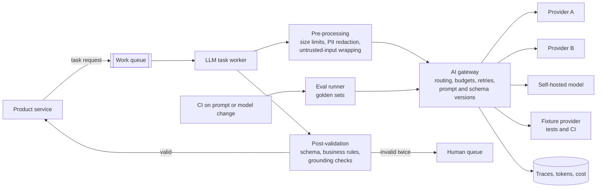
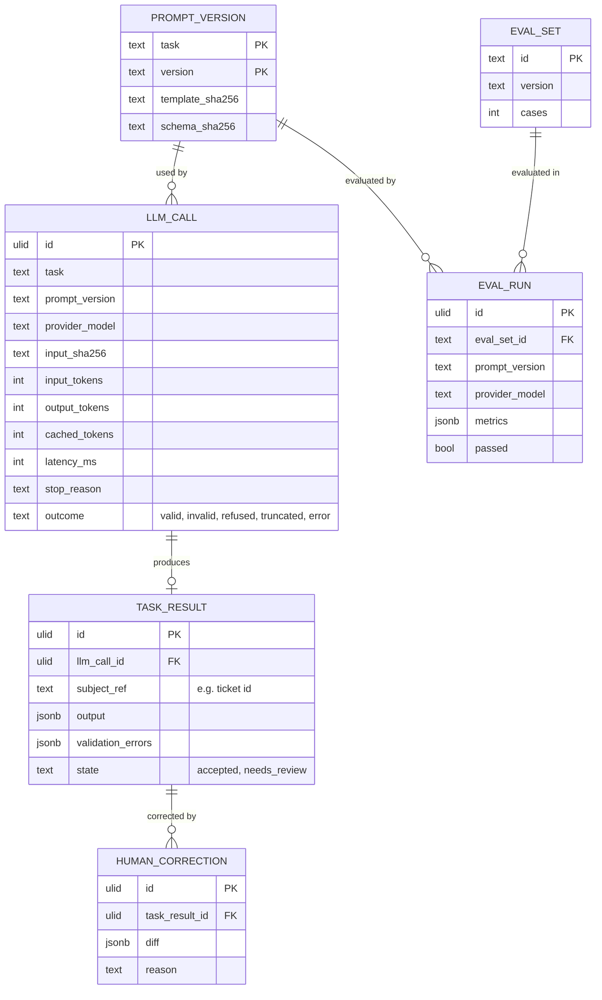
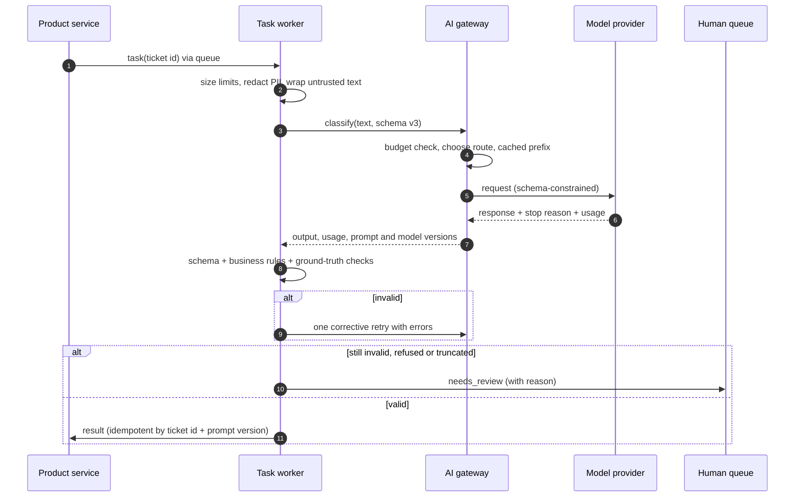
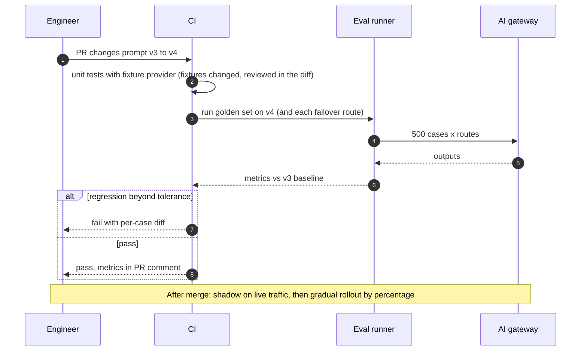

# LLM features in production: an architect's checklist

What I check before an LLM-backed feature ships, and the reference architecture behind the checks. This one is
different from the other designs here: it's a checklist for a *class* of system, not one system. It still follows
the same outline, using a worked example to make the numbers concrete.

> **Related code.** Each item links to where one of my public repos applies it:
>
> - [loan-underwriting-ai](https://github.com/adilKhan72/loan-underwriting-ai): extraction in a regulated flow,
>   PII redaction, deterministic decisions, fixture-based tests. Complete.
> - [ai-code-review-action](https://github.com/adilKhan72/ai-code-review-action): untrusted input, output validated
>   against ground truth (the diff), cost guardrails before any call. In development; not yet run against a live model.
> - [rag-docs-assistant](https://github.com/adilKhan72/rag-docs-assistant): retrieval evals as a CI gate, verified
>   citations, "I don't know". In development; ingestion is done, retrieval and answers are planned.
>
> Where a repo hasn't implemented something yet, the link points at its design (ADR), and this page says so.

## Contents

- [Problem and requirements](#problem-and-requirements)
- [Capacity estimates](#capacity-estimates)
- [High-level architecture](#high-level-architecture)
- [The checklist](#the-checklist)
- [Data model](#data-model)
- [Key flows](#key-flows)
- [Scaling and bottlenecks](#scaling-and-bottlenecks)
- [Failure modes](#failure-modes)
- [Consistency and idempotency](#consistency-and-idempotency)
- [Security and compliance](#security-and-compliance)
- [Observability](#observability)
- [Trade-offs considered and rejected](#trade-offs-considered-and-rejected)
- [ADRs](#adrs)

## Problem and requirements

Most production LLM features fall into a few shapes: **extract** (unstructured input → typed fields),
**classify or route**, **generate** (summaries, explanations, drafts), and **answer from sources** (RAG). The
failures are also predictable: wrong but plausible output, prompt injection through the input, personal data
sent where it shouldn't go, cost that scales with input size, provider outages, and quality that drifts silently
when a model, a prompt or the input changes.

**Worked example used for the numbers:** support-ticket triage for a B2B SaaS. Each incoming ticket is classified
(product area, severity, intent), key fields are extracted (account, error codes), and a draft first reply is
suggested to the agent.

| Requirement | Target | Why |
|---|---|---|
| Volume | 50,000 tickets/day, busiest hour 12% of the day | Mid-sized SaaS support |
| Latency | p95 ≤ 5 s for triage (async is fine); draft reply p95 ≤ 10 s | The agent opens the ticket a minute later at best |
| Quality | Routing accuracy ≥ 95% on the golden set; no draft sent without an agent's approval | Misrouting costs hours; a bad auto-reply costs a customer |
| Data | No customer secrets or card numbers reach a third-party model; provider retention off | Contracts and privacy law |
| Availability | Feature degrades to manual triage, never blocks ticket intake | The LLM is an accelerator, not the system of record |

## Capacity estimates

**Tokens.** Per ticket: about 1,000 tokens of ticket text and 500 of instructions and schema (1,500 in), and
about 200 out for the triage JSON. The draft reply is a second call: about 2,000 in (ticket plus retrieved help
articles) and 300 out.

- Triage: 50,000 × 1,500 = 75M in, 50,000 × 200 = 10M out per day.
- Drafts (opened for, say, 60% of tickets): 30,000 × 2,000 = 60M in, 30,000 × 300 = 9M out.
- Total: **135M input and 19M output tokens/day**.

**Cost** with illustrative prices of $3 per million input and $15 per million output tokens:
135 × 3 + 19 × 15 = $405 + $285 = **$690/day**, about $0.014 per ticket. Prompt caching of the static 500-token
prefix saves roughly a fifth of triage input. Plug in real prices; the structure of the sum is the point.

**Rate limits.** Busiest hour: 6,000 tickets → 6,000 × (1,700 + 2,300 × 0.6) / 60 ≈ **310k tokens/min**.
Check that against the account's tokens-per-minute limit *before* launch, including retries and evals.

**Concurrency.** 6,000 / 3,600 ≈ 1.7 tickets/s × about 1.6 calls each × about 3 s per call ≈ **8 calls in flight**.
Tiny. The work queue is for smoothing bursts and retries, not throughput.

**Evals are cheap, so run them.** A 500-case golden set × 3 routes (primary and two fallbacks) is 1,500 calls,
about 2.5M tokens: roughly **$10 per full evaluation run**. There's no cost argument for skipping evals on every
prompt change.

**The number that matters more.** If a misrouted ticket costs 30 minutes of agent time and the model is 2 points
less accurate than it could be, that's 1,000 tickets × 0.5 h = 500 hours a day. Quality dominates token cost by
orders of magnitude, so the evaluation set is the most valuable artefact in the system.

## High-level architecture

| Component | Responsibility |
|---|---|
| Work queue | Decouples the product from model latency and outages; retries with backoff |
| Pre-processing | Enforce size limits *before* the call; redact PII; wrap untrusted input in delimiters the prompt treats as data |
| AI gateway | Task-level interface, provider routing, token budgets and priorities, evaluated failover, versioned prompts and schemas. Detailed in the [loan underwriting design's ADR-0002](../loan-underwriting-platform/adr/0002-ai-gateway-with-token-budgets-and-failover.md) |
| Post-validation | Schema, business rules, and grounding against ground truth (diff lines, retrieved sources, document totals). See [ADR-0002](adr/0002-validate-against-ground-truth-not-the-models-word.md) |
| Fixture provider | Deterministic recorded answers keyed by a hash of prompt + input + schema, so tests and CI never call a network model |
| Eval runner | Golden sets per task; gates prompt and model changes in CI. See [ADR-0001](adr/0001-evals-gate-every-prompt-and-model-change.md) |

## The checklist

### 1. Should this be an LLM at all?

- [ ] The task is genuinely fuzzy (messy documents, natural language). If a regex, a lookup or a small classifier
  meets the quality bar, use that.
- [ ] **The determinism boundary is explicit.** Decisions with legal, financial or safety impact are made by code over
  validated LLM output, not by the LLM. *Applied:* [loan-underwriting-ai ADR-0001](https://github.com/adilKhan72/loan-underwriting-ai/blob/main/docs/adr/0001-rules-decide-llm-explains.md).
- [ ] The feature has a non-LLM fallback (manual path, simpler heuristic) and the product works when it's used.

### 2. Providers and models

- [ ] Task-level interface (`extract`, `classify`, `explain`), not vendor SDK calls scattered through the codebase.
  *Applied:* [loan-underwriting-ai ADR-0003](https://github.com/adilKhan72/loan-underwriting-ai/blob/main/docs/adr/0003-pluggable-llm-providers.md),
  [ai-code-review-action ADR-0002](https://github.com/adilKhan72/ai-code-review-action/blob/main/docs/adr/0002-pluggable-providers-with-native-structured-output.md).
- [ ] Model ids are pinned (exact versions where the provider offers them) and changed deliberately, with an eval run.
- [ ] Data terms are checked per provider: retention, training on inputs, region. Recorded next to the adapter.
- [ ] A self-hosted option exists for data that can't leave, even if it's slower or weaker.

### 3. Structured output

- [ ] Use the provider's native schema-constrained output (JSON schema / tool input schema / grammar), not
  "please answer in JSON".
- [ ] **Re-validate anyway**: types, enums, ranges, cross-field rules (net ≤ gross). Required-but-nullable fields so
  the model can say "not present" instead of inventing.
- [ ] Check stop reasons: refusal and max-tokens truncation are handled as distinct errors, not parsed as content.
- [ ] One corrective retry with the validation errors, then a human. Never loop.
  *Applied:* [loan-underwriting-ai](https://github.com/adilKhan72/loan-underwriting-ai#ai-service).

### 4. Prompts as versioned artefacts

- [ ] Prompts and schemas live in the repository, are reviewed like code, and carry a version that's stored with
  every output.
- [ ] Any prompt change shows up in review as changed fixtures or eval results, not only as changed text.

### 5. Evals

- [ ] A golden set per task, built from real (anonymised) cases, including the hard and adversarial ones.
  Start with 50–100 and grow it from production failures.
- [ ] Deterministic metrics where possible (exact match on fields, accuracy, recall@k). LLM-as-judge only for
  qualities with no ground truth, calibrated against human labels.
- [ ] **Evals gate CI** for prompt, schema and model changes ([ADR-0001](adr/0001-evals-gate-every-prompt-and-model-change.md)).
  *Applied (design):* [rag-docs-assistant ADR-0004](https://github.com/adilKhan72/rag-docs-assistant/blob/main/docs/adr/0004-retrieval-evals-gate-ci.md).
- [ ] Unit and integration tests use a fixture provider, so CI is free, fast and deterministic.
- [ ] Online evaluation: sample production outputs for human review, and track the human-correction rate.

### 6. Guardrails and prompt injection

- [ ] All user- or third-party-supplied text is **untrusted input**: wrapped in clear delimiters, with an
  instruction that its content is data. *Applied:* [ai-code-review-action ADR-0003](https://github.com/adilKhan72/ai-code-review-action/blob/main/docs/adr/0003-diff-is-untrusted-input.md).
- [ ] The real defence is **capability limits, not prompts**: the model's output can't trigger actions beyond what
  the feature needs. No tools with write access unless required, and every action validated by code.
- [ ] **Validate against ground truth**: comments only on lines that exist in the diff, citations only to
  retrieved chunks, extracted totals that reconcile with the document. See
  [ADR-0002](adr/0002-validate-against-ground-truth-not-the-models-word.md).
- [ ] Generated text shown to end users passes output checks (no internal codes, no leaked prompt, no unsafe content).
- [ ] RAG answers say "I don't know" when the evidence is weak. *Applied (design):*
  [rag-docs-assistant ADR-0003](https://github.com/adilKhan72/rag-docs-assistant/blob/main/docs/adr/0003-citations-are-verified-not-trusted.md).

### 7. PII and data governance

- [ ] Redact before the call, in one code path for every provider, including self-hosted.
  *Applied:* [loan-underwriting-ai ADR-0004](https://github.com/adilKhan72/loan-underwriting-ai/blob/main/docs/adr/0004-pii-never-reaches-the-model.md).
- [ ] Logs and traces store token counts, versions and hashes, not prompts and completions, by default. Full payload
  capture is sampled, access-controlled and time-limited.
- [ ] The data-protection impact assessment covers the provider as a processor, and the records of processing say so.

### 8. Cost and capacity

- [ ] The token arithmetic is written down (as in [capacity estimates](#capacity-estimates)) and checked against
  rate limits, including retries and evals.
- [ ] **Hard limits before the call**: input size, number of chunks, max output tokens. Oversized input is skipped
  or summarised, never sent whole. *Applied:* [ai-code-review-action](https://github.com/adilKhan72/ai-code-review-action) guardrails.
- [ ] Per-feature and per-tenant budgets with alerts at 80%.
- [ ] Prompt caching for static prefixes; response caching for identical requests where outputs may be reused.
- [ ] Smallest model that passes the evals. Re-run the comparison when new models ship.

### 9. Latency

- [ ] Async by default (queue + notify). Synchronous only when the user is waiting and the budget allows it.
- [ ] Streaming for long generated text shown to a person. Not for structured output, which is validated as a whole.
- [ ] Timeouts per call, and an overall deadline per task.

### 10. Fallbacks and failure handling

- [ ] Retry with jittered backoff on 429, 5xx and overloaded responses, honouring `Retry-After`.
- [ ] Failover only to routes that passed the same evals. No silent fallback to "any model".
- [ ] A bad input never causes a retry loop: validation failures go to a human, outages go to retry.
- [ ] Partial results are labelled as partial (for example "partially reviewed"), never presented as complete.

### 11. Rollout

- [ ] Shadow mode first: run on live traffic, store outputs, show nothing, compare with human outcomes.
- [ ] Then human-in-the-loop (suggestions), and only then automation for the confident, low-risk slice.
- [ ] A kill switch per feature that falls back to the manual path.

## Data model

The minimum records that make an LLM feature debuggable and auditable:

`HUMAN_CORRECTION` closes the loop: corrected cases become new golden cases, and later training data if
fine-tuning ever pays off.

## Key flows

### One task, end to end

### Changing a prompt or a model

## Scaling and bottlenecks

1. **Provider rate limits** come first, usually tokens per minute. Budgets and priorities in the gateway; batch work
   uses leftover capacity; a second provider only if evaluated.
2. **Input size** is the cost driver, not request count. Bound it in pre-processing (chunking, excluding generated
   content, summarising history).
3. **Human review capacity** is the real ceiling of any "LLM + human fallback" design. Track the needs-review rate as
   carefully as latency.
4. **At 10×**, cost justifies routing easy cases to a small model (a cascade, with the large model for low-confidence
   cases), or a fine-tuned or self-hosted model, still behind the same task interface and gated by the same evals.

## Failure modes

| Failure | Detection | Handling |
|---|---|---|
| Provider outage, 429 or overload | Gateway error rates | Backoff, evaluated failover, then queue. Product falls back to manual |
| Plausible but wrong output | Ground-truth checks, sampled human review, correction rate | Validation catches what can be checked. Correction rate alerts catch drift |
| Prompt injection in the input | Output validation, capability limits | Untrusted input wrapping; no write tools; actions validated by code |
| Model change by provider under the same name | Eval metrics on a schedule, not only on PRs | Pin versions; nightly eval run against production routes |
| Truncation (max tokens) | Stop reason | Treated as an error, never parsed. Raise the limit or split the input |
| Cost spike from huge inputs | Tokens per request percentiles | Hard size limits before the call |
| PII leak to a provider | Outbound sampling, redaction counts | Redaction in one path; provider zero retention as the second layer |

## Consistency and idempotency

- LLM calls are **not idempotent** in output (sampling, model updates). The *task* is made idempotent instead:
  results are keyed by (subject, task, prompt version), and a redelivered task returns the stored result.
- Where reproducibility matters, store the output and the versions, and replay *downstream* logic from the stored
  output. Don't expect the model to repeat itself.
- Temperature 0 reduces variation but doesn't guarantee determinism across providers or hardware. Don't design on it.

## Security and compliance

- The model is an untrusted component on both sides: its input may be hostile and its output may be wrong.
  Treat output as user input to the rest of the system (validate, escape, never execute).
- Secrets: provider keys in a secrets manager, one per environment and feature, with spend limits set on the provider side too.
- Regulated decisions (credit, employment, insurance) keep the model out of the decision itself, so explanations and
  bias testing remain tractable.
- Records: store versions and hashes for every call, so "what did the system do and why" is answerable later
  without keeping every payload.

## Observability

| Signal | Why |
|---|---|
| Outcome mix per task: valid, invalid, refused, truncated, error | The first sign of a prompt, model or input change |
| Needs-review and human-correction rates | Quality in production, and the human cost |
| Tokens and cost per task, per tenant, per prompt version | Budget alerts; spotting a prompt change that doubled cost |
| Latency p50/p95 per route, and queue lag | SLOs and capacity |
| Failover count and route mix | Should be near zero; any failover is investigated |
| Eval metrics over time (nightly) | Catches provider-side model changes |

## Trade-offs considered and rejected

| Option | Why not |
|---|---|
| **Call vendor SDKs directly from product code** | Spreads retries, budgets, versions and PII handling across every team. One gateway, one place to fix |
| **Free-form text output parsed with regexes** | Fragile. Native structured output is available from all major providers and local runtimes |
| **LLM-as-judge for everything** | Expensive and noisy where ground truth exists. Use deterministic metrics first |
| **Fine-tune first** | Needs labelled data that only exists after the feature runs. Start with prompting and evals; fine-tune when volume and corrections justify it |
| **Agents with broad tool access for simple tasks** | Bigger attack surface and harder evals. Use a fixed pipeline unless the task needs planning |

## ADRs

- [ADR-0001: Evals gate every prompt and model change](adr/0001-evals-gate-every-prompt-and-model-change.md)
- [ADR-0002: Validate against ground truth, not the model's word](adr/0002-validate-against-ground-truth-not-the-models-word.md)
- Related: [AI gateway with token budgets and evaluated failover](../loan-underwriting-platform/adr/0002-ai-gateway-with-token-budgets-and-failover.md) (from the loan underwriting design)
