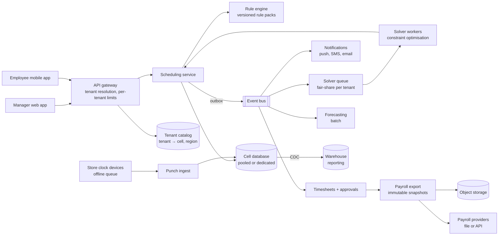
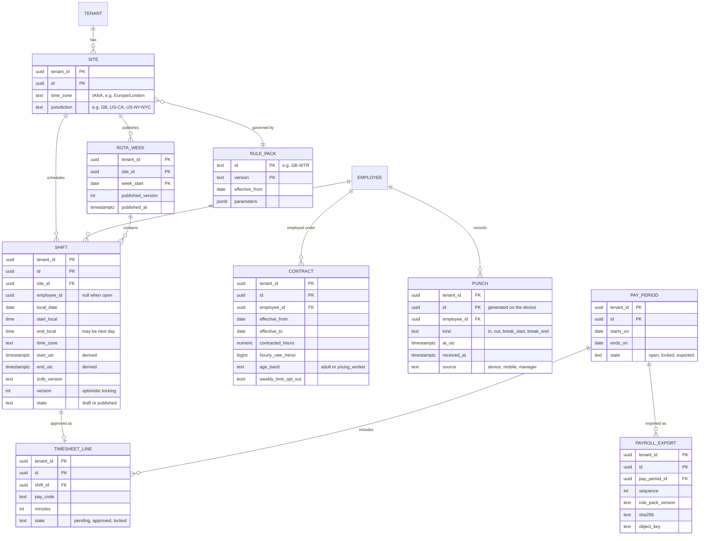
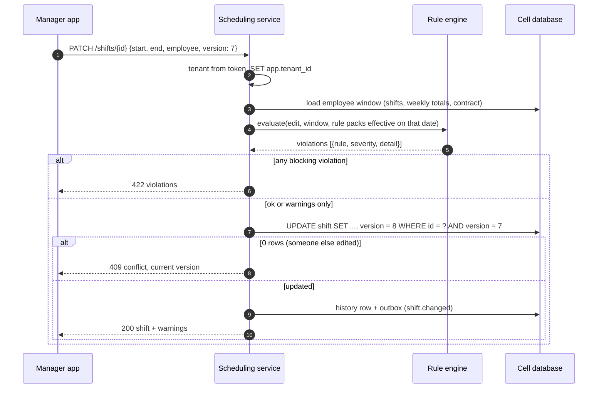
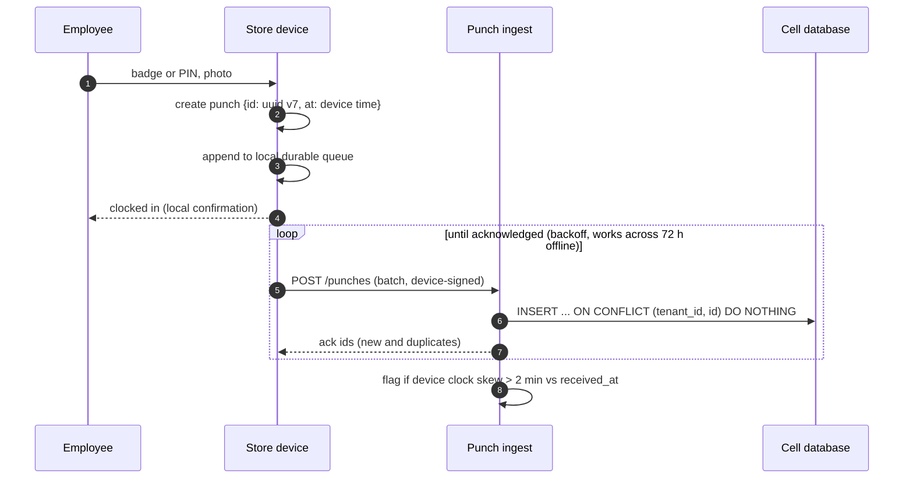
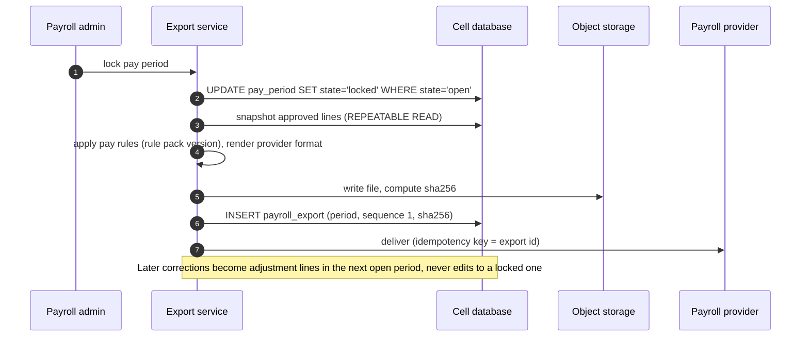

# Multi-tenant workforce scheduling SaaS

A B2B SaaS that retail and hospitality employers use to forecast demand, build and publish staff rotas, record
clock-ins, enforce labour law, and export approved hours to payroll. Hundreds of tenants share one platform,
ranging from a 30-person café chain to a retailer with tens of thousands of staff.

> **Related code:** none. This is a generic design drawn from the problem space, not from any product.

## Contents

- [Problem and requirements](#problem-and-requirements)
- [Capacity estimates](#capacity-estimates)
- [High-level architecture](#high-level-architecture)
- [Tenancy model](#tenancy-model)
- [Data model](#data-model)
- [Time, time zones and DST](#time-time-zones-and-dst)
- [Labour-law rule engine](#labour-law-rule-engine)
- [Key flows](#key-flows)
- [Scaling, bottlenecks and noisy neighbours](#scaling-bottlenecks-and-noisy-neighbours)
- [Failure modes](#failure-modes)
- [Consistency and idempotency](#consistency-and-idempotency)
- [Security and compliance](#security-and-compliance)
- [Observability](#observability)
- [Trade-offs considered and rejected](#trade-offs-considered-and-rejected)
- [ADRs](#adrs)

## Problem and requirements

### Functional requirements

1. **Organisation model** per tenant: regions → sites (each with a time zone and a jurisdiction) → departments,
   employees with contracts (contracted hours, pay rates over time, skills, age band, availability, leave).
2. **Demand and scheduling:** forecast labour demand per site and 15-minute interval from sales and footfall.
   Generate a draft rota automatically, then managers edit it by hand.
3. **Rule enforcement:** every edit is checked against labour law (per jurisdiction), the tenant's own agreements
   (e.g. a union agreement or company policy) and the employee's contract. Violations either block or warn.
4. **Publish** the rota to employees (mobile app, notifications). Changes after publishing are tracked, because
   some jurisdictions require notice and premium pay for late changes.
5. **Time and attendance:** clock-in/out from shared in-store devices and the mobile app (with geofencing),
   including offline devices. Managers approve timesheets.
6. **Payroll export:** per pay period, an immutable export of approved hours, premiums and absences, in the format of
   the tenant's payroll provider (file or API).
7. **Tenant administration:** SSO, user provisioning, roles, configuration of rules, pay codes and integrations.

### Non-functional requirements

Assumptions for a mid-sized vertical SaaS:

| Requirement | Target | Why |
|---|---|---|
| Tenants | 200, from 30 to 80,000 employees each; 500,000 employees total | Typical long tail plus a handful of whales |
| Edit latency (with rule check) | p95 ≤ 300 ms | Managers drag shifts around a grid; slow validation kills adoption |
| Clock-in availability | 99.95%, and devices keep working offline for 72 h | A failed clock-in is a wage dispute |
| Clock-in latency | p95 ≤ 500 ms online | Queue at the staff door at 06:55 |
| Auto-schedule turnaround | 95% of site solves within 15 min of request on planning day | Managers plan in a fixed window |
| Payroll export | Largest tenant's export ≤ 30 min, byte-for-byte reproducible | Payroll cut-off is a hard deadline |
| Isolation | No cross-tenant data access, ever; one tenant's load can't degrade another's SLOs | Enterprise contracts and security reviews |
| Data residency | UK/EU tenants' data stays in-region | Common enterprise requirement |
| Retention | Working-time and pay records 6 years | Covers typical record-keeping and claim periods in the UK |

## Capacity estimates

**Shifts and edits.**

- 500,000 employees × 4 shifts/week (part-time heavy) = **2M shifts/week**, about 104M/year.
- About 1 manager per 25 employees, so 20,000 managers. Assume 200 edits each per week: **4M edits/week**.
  If the busiest hour carries 3% of the week: 120,000/h ≈ **33 edits/s**, each with a rule check.

**Clock events** (the spikiest load).

- 4 punches per shift (in, out, break start, break end): 8M/week ≈ **1.15M/day**, 1.5M on a busy Saturday.
- Openings cluster. If 10% of a day's punches land in the busiest 15 minutes: 1.5M × 0.10 / 900 s ≈ **170 punches/s**.
  Most UK tenants share one time zone, so there is no geographic smoothing. Add 30% for seasonal staff in December
  and 2× headroom: design for **500 punches/s**.

**Auto-scheduling** (the most expensive load per request).

- About 25,000 sites. A weekly solve is a constraint-optimisation problem; assume about 60 CPU-seconds for an average
  site (with a time limit) and up to 5 CPU-minutes for the largest.
- 25,000 × 60 s = 1.5M CPU-s ≈ **417 CPU-hours/week**.
- Planning clusters: if 40% of solves are requested in a 4-hour window on the planning evening,
  that's 167 CPU-hours in 4 h ≈ **42 cores** busy for the whole window.
- **The noisy-neighbour case:** the largest tenant has 1,500 sites. One "schedule all sites" click is
  1,500 × 60 s = 25 CPU-hours. On a 48-core pool with plain FIFO, that click takes the pool for about 30 minutes,
  and every other tenant's solves wait behind it. This is why the solver queue is fair-share per tenant (see
  [noisy neighbours](#scaling-bottlenecks-and-noisy-neighbours)).

**Storage** (including indexes, roughly 2.5× the raw row size).

| Data | Rows/year | Size/year |
|---|---|---|
| Shifts (plus versions) | 104M | ≈ 100 GB |
| Punches | 416M | ≈ 100 GB |
| Schedule change history | 200M | ≈ 60 GB |
| Timesheets, absences, exports, audit | | ≈ 40 GB |
| **Total** | | **≈ 300 GB/year**, ≈ 1.8 TB at 6 years |

One PostgreSQL cluster can hold this. The issue isn't total size but skew: the 5 largest tenants are about 40% of
employees, so they're about 40% of every table, every vacuum and every migration. That shapes the
[tenancy model](#tenancy-model).

**Payroll export.** The largest tenant has 80,000 employees × about 10 lines each (hours by pay code, premiums,
absences) = **800,000 lines** per period. Generating that from a consistent snapshot in minutes is easy. The hard
part is making it reproducible.

## High-level architecture

| Component | Responsibility | Notes |
|---|---|---|
| API gateway | Authenticates, resolves the tenant, routes to the tenant's cell, enforces per-tenant rate limits | Tenant id comes from the token, never from the request body |
| Tenant catalog | Maps tenant → cell (database and region), plan, feature flags | Small, cached everywhere, changes rarely |
| Scheduling service | Rotas, shifts, availability, publishing; runs the rule engine on every change | Stateless; deployed per region |
| Rule engine | Evaluates labour-law and agreement rules incrementally on edits, fully on publish and export | A library in the scheduling service, not a network hop. See [ADR-0003](adr/0003-labour-rules-as-versioned-effective-dated-rule-packs.md) |
| Punch ingest | High-availability clock-in path, separate from the rota API; accepts batched offline punches | Idempotent by device-generated punch id |
| Solver | Builds draft rotas from forecast demand under hard constraints (law, contracts, availability) and soft objectives (cost, fairness, preferences) | Separate autoscaled pool; fair-share queue |
| Timesheets | Match punches to shifts, apply rounding and premium rules, manager approval | |
| Payroll export | Locks a pay period, snapshots approved timesheets, renders provider-specific formats, delivers | Immutable once delivered; corrections go into the next period |
| Warehouse | Cross-site reporting and analytics, fed by change data capture | Keeps heavy reporting queries off the transactional database |

A **cell** is a deployment of the stateful parts (database, cache, queues) serving a set of tenants in one region.
Most tenants share a pooled cell; the largest have a cell to themselves.

## Tenancy model

The three classic models, compared for this workload:

| | Shared schema, `tenant_id` column | Schema per tenant | Database per tenant |
|---|---|---|---|
| Isolation | Logical: every query must filter. Row-level security makes it enforced, not hoped for | Better: `search_path` scopes queries, but one bad `SET` leaks | Strongest: separate credentials and storage |
| Noisy neighbours | Shared everything: vacuum, locks, buffer cache | Same database, same resources | Isolated, if on separate hosts |
| Migrations | One migration | N migrations; partial failure leaves tenants on different versions | N migrations across N databases; needs fleet tooling |
| Cost per small tenant | Lowest | Low, until catalog bloat at thousands of schemas | Highest: idle databases still cost memory and connections |
| Connection pooling | Simple | Pool per schema, or `SET search_path` per transaction (error-prone with transaction pooling) | Pool per database; connection count grows with tenants |
| Per-tenant restore, export, deletion | Hard: tenant rows are mixed with others | Easy (dump one schema) | Easiest |
| Cross-tenant analytics | Easy | Awkward | Needs a warehouse |
| Data residency | Needs regional deployments anyway | Same | Natural |

**Decision: a hybrid, chosen per tenant** ([ADR-0001](adr/0001-hybrid-tenancy-pooled-cells-with-dedicated-cells-for-large-tenants.md)).

- **Pooled cells** (shared schema, `tenant_id` on every table, PostgreSQL row-level security) for the long tail.
  About 190 tenants, 300,000 employees.
- **Dedicated cells** (the same schema in its own database, and own host) for the handful of tenants whose size,
  contract or residency requires it.
- **One schema, one codebase, one migration path.** A dedicated cell is just a pooled cell with one tenant.
  `tenant_id` stays in every table and every primary key even there, so a tenant can be moved between cells by
  copying its rows, with no schema transformation.
- Schema-per-tenant is rejected outright: it combines the migration fan-out of database-per-tenant with the shared
  resources of the pooled model.

## Data model

Conventions that matter:

- **`tenant_id` leads every primary key and every index.** Queries within a tenant use index prefixes, RLS policies
  are cheap (`tenant_id = current_setting('app.tenant_id')::uuid`), and the layout is ready for hash-partitioning or
  a sharded PostgreSQL by tenant if a pooled cell outgrows one node.
- **Effective-dated contracts and pay rates.** A rate change never updates history; it closes one row and opens another.
  Payroll for a past period always uses the rate that was in effect then.
- **Shifts are versioned** (optimistic locking with `version`), and every change goes to a history table with the
  actor and reason, because late changes may trigger premium pay.
- **Punches are immutable facts.** Corrections are new manager punches that supersede old ones, with a reason.

## Time, time zones and DST

Scheduling is one of the few domains where storing only UTC is wrong. Details are in
[ADR-0002](adr/0002-wall-clock-time-as-source-of-truth-for-future-shifts.md).

- **A future shift is a promise in local wall-clock time.** "Saturday 09:00–17:00 at the Leeds store" must stay
  09:00 local even if time-zone rules change between now and then. So the source of truth is
  `(local_date, start_local, end_local, time_zone)`. `start_utc` and `end_utc` are derived, stored for indexing,
  and recomputed when the tz database changes (the `tzdb_version` column shows which rows are stale).
- **A punch is a fact in absolute time**, captured as a UTC instant from a device clock (and checked against
  server receive time for skew). Hours worked are computed from instants, never from wall-clock differences.
- **DST transitions are handled explicitly:**
  - A night shift 22:00–06:00 on the night clocks go forward is **7 hours** of real time. On the night they go back,
    it's **9 hours**. Pay is for hours actually worked (from instants). The rota grid shows the real duration and a
    DST marker, so managers aren't surprised.
  - A shift starting in the skipped hour (01:30 on spring-forward night in the UK) is invalid and rejected at entry.
    A shift starting in the repeated hour (01:30 on fall-back night) is ambiguous and needs an explicit choice. The
    default is the first occurrence, shown in the UI.
- **"Day" and "week" are local** for rules. "11 hours rest between shifts" and "max 8 hours in a day" are evaluated
  on instants, but "per day" and "per week" boundaries are the site's local midnight and the tenant's configured
  week start.
- **Employees working across sites in different zones** (rare in the UK, common in the US) are evaluated on
  instants for rest rules, and per site jurisdiction for daily and weekly rules.

## Labour-law rule engine

Rules come from three sources, layered: **law** (per jurisdiction), **agreements** (tenant-level collective
or company policy, which can only be stricter than law or add premiums), and **contract** (per employee, such as
maximum contracted hours or an opt-out).

Examples of what the rule packs encode (summarised; not legal advice):

| Jurisdiction | Rule | Kind |
|---|---|---|
| GB (Working Time Regulations) | 11 consecutive hours' daily rest | Block or warn (tenant choice) |
| GB | 24 hours' uninterrupted weekly rest per 7 days (or 48 per 14) | Warn |
| GB | 20-minute break when working more than 6 hours | Block |
| GB | Average ≤ 48 hours/week over a 17-week reference period, unless opted out | Warn, with a forward projection |
| GB, young workers | ≤ 8 h/day and 40 h/week, 12 h daily rest, 30-minute break over 4.5 h | Block |
| US federal (FLSA) | Overtime premium over 40 hours in a workweek | Pay rule (premium), not a block |
| US-CA | Daily overtime over 8 h, double time over 12 h; seventh-day rules | Pay rule |
| US cities with fair-workweek laws | Advance notice of schedules (e.g. 14 days), premium pay for late changes, minimum rest between closing and opening shifts | Pay rule + warn |

How it runs ([ADR-0003](adr/0003-labour-rules-as-versioned-effective-dated-rule-packs.md)):

- **Rules are code, parameters are data.** Each rule type (`min_rest_between_shifts`, `max_hours_in_window`,
  `break_required`, `overtime_threshold`, `late_change_premium`) is a tested, deterministic function. A rule pack is a
  versioned, effective-dated set of rule instances with parameters, per jurisdiction or agreement.
- **Incremental evaluation on edit.** An edit to one shift only affects one employee, over a bounded window:
  the shift's day and week, the neighbouring shifts for rest rules, and the reference period for averages. The
  engine loads that employee's shifts in the affected window, plus **precomputed weekly totals** for long reference
  periods (17 weeks would otherwise be 17 weeks of shifts per edit). That keeps a check at about one indexed
  read and some microseconds of CPU, well inside the 300 ms edit budget.
- **Full evaluation on publish and export.** Publishing a week re-checks every shift in it. Payroll export
  evaluates pay rules (overtime, premiums) on approved timesheets and records the rule pack version in the export.
- **Explainable results.** A violation names the rule, the pack version, the parameters and the shifts involved:
  "Rest between Fri 22:00 and Sat 06:00 is 8 h; GB-WTR v3 requires 11 h."

## Key flows

### Manager edits a shift

### Clock-in, including offline devices

### Payroll export

Re-running an export for a locked period produces the same bytes (same snapshot rows, same rule pack version,
deterministic ordering). The export's sha256 makes that checkable.

## Scaling, bottlenecks and noisy neighbours

Noisy neighbours are the defining scaling problem. Every shared resource gets a per-tenant limit:

| Shared resource | How one tenant hurts others | Control |
|---|---|---|
| API | A tenant's integration polls 500 req/s | Per-tenant token buckets at the gateway, sized by plan; `429` with `Retry-After` |
| Solver pool | One "schedule all 1,500 sites" click | Fair-share queue: each tenant's jobs in its own sub-queue, served round-robin, weighted by plan, with a per-tenant concurrency cap. A whale's bulk run uses idle capacity but can't starve small tenants |
| Database CPU and I/O | A huge report or export query | Reports go to the warehouse; exports read from a replica snapshot; `statement_timeout` per role; per-tenant connection limits in the pooler |
| Database locks and vacuum | Bulk import of 80,000 employees | Bulk jobs run in batches of 1,000 rows with pauses; large tenants live in dedicated cells anyway |
| Notifications | Publishing 1,500 sites' rotas at once fans out to 80,000 phones | Per-tenant send rate, queued; providers' rate limits are per account, so whales may get their own sender pool |

Bottlenecks in order:

1. **Planning-evening solver load.** Autoscale the pool on queue depth (scale-out takes minutes, so pre-scale on a
   schedule for the known peak). Cap each solve with a time limit and return the best found solution.
2. **Morning punch spikes** (about 500/s at design peak) are small for the database, but they must not queue
   behind anything else. The punch ingest path is separate, has its own connection pool, and only does an
   idempotent insert. Matching punches to shifts is asynchronous.
3. **Pooled-cell growth.** At about 1–2 TB or when one tenant exceeds about 15% of a pooled cell, move that tenant
   to a dedicated cell (logical replication of its rows, then a catalog switch during a short write freeze), or
   open a new pooled cell for new tenants. Cells are the unit of scale, blast radius and residency.
4. **Read-heavy rota views.** The weekly grid for a big site is the most frequent read. Cache it per
   (tenant, site, week, version), invalidated by `shift.changed` events.

## Failure modes

| Failure | Detection | Handling |
|---|---|---|
| Cross-tenant data leak via a missed filter | RLS denies; automated tests run every endpoint as tenant A against tenant B's ids | RLS is the backstop, not the primary control: repository code always scopes by tenant. CI fails on any table without an RLS policy |
| Store device offline (network down at opening) | Device heartbeat | Local durable queue, 72 h; idempotent upload by punch id; managers see "pending sync" |
| Device clock wrong | Skew between `at_utc` and `received_at` | Flag for manager review; never silently rewrite |
| Solver times out or finds no feasible rota | Solver status | Return the best partial solution with unfilled shifts as open shifts, and the binding constraints ("no qualified employee available Sat 06:00") |
| Concurrent edits to the same shift | Version check | `409` with the current state; the UI merges or asks |
| tz database update changes a zone's rules | tzdb version deploy | Background job recomputes `start_utc` for future shifts in affected zones; notifies managers of any shift whose real duration changed |
| Payroll provider rejects or times out | Delivery status | Retry with the same idempotency key; the file in object storage is the evidence; alert the tenant's admin |
| Pooled cell's database is down | Health checks | Only that cell's tenants are affected (blast radius = cell). Punch devices keep queueing locally |
| Bad rule pack release | Shadow evaluation diff | New pack versions run in shadow against the last 4 weeks of shifts; the diff in violations is reviewed before activation |

## Consistency and idempotency

- **Strong consistency within a tenant's cell.** Shift edits use optimistic locking; publish and pay-period locks
  are conditional state transitions.
- **Events through an outbox.** `shift.changed`, `rota.published` and `period.locked` are written in the same
  transaction as the change. Notifications, caches, timesheets and the warehouse consume them at least once and
  are idempotent by event id.
- **Punches** are idempotent by device-generated UUIDv7. Late (offline) punches are expected and are matched to
  shifts whenever they arrive. If they arrive after the pay period is locked, they go into the next period as an adjustment.
- **Payroll exports are immutable** and reproducible. Corrections flow forward, never backwards, which is how
  payroll systems themselves work.
- **Cross-cell operations** (tenant moves) use a write freeze for the tenant and a catalog switch. There are no
  distributed transactions across cells.

## Security and compliance

- **Tenant isolation:** tenant id from the authenticated token only; RLS on every tenant table; per-cell database
  credentials; automated cross-tenant tests in CI. Dedicated cells add separate credentials and storage.
- **Identity:** per-tenant SSO (SAML / OIDC), SCIM provisioning so leavers lose access the day HR offboards them,
  and role-based access scoped to sites and departments.
- **Personal data:** employee records are personal data under UK GDPR / GDPR. Data minimisation (no national
  insurance numbers unless the payroll integration needs them, and then encrypted), retention schedules per
  record type, and per-tenant export and deletion tooling. Pooled cells make per-tenant restore hard, so logical
  per-tenant exports run nightly in addition to cluster backups.
- **Special care data:** photos at clock-in (to deter buddy punching) and geolocation are sensitive. Both are
  tenant opt-in, retained briefly, and disclosed to employees. Biometric templates are avoided by design.
- **Residency:** cells are regional, and the tenant catalog pins a tenant to a region. Backups stay in-region.
- **Audit:** every schedule change, approval, export and admin action is audited with the actor. Employees can
  see their own change history, which also helps with late-change premium disputes.

## Observability

| SLI / signal | Target or alert |
|---|---|
| Shift edit latency (including rule check) | p95 ≤ 300 ms, per cell and per tenant tier |
| Punch ingest success and latency | 99.95%; p95 ≤ 500 ms; page on error rate > 0.5% for 5 min |
| Devices with unsynced punches older than 1 h | Alert per tenant (store connectivity issue) |
| Solver queue wait per tenant | p95 ≤ 15 min on planning evenings; alert on any tenant starved > 30 min |
| Solver infeasibility rate | Trend per tenant; a jump usually means bad configuration (availability or skills) |
| Payroll export duration and delivery | Alert before the tenant's payroll cut-off, not after |
| Per-tenant resource use | Requests, DB time, solver CPU per tenant: the data needed to spot and bill the noisy neighbour |
| RLS denials | Should be zero. Any denial is a bug in scoping code and is investigated |

Every log line and span carries `tenant_id` and `cell`, so per-tenant SLOs can be computed. Enterprise customers ask for them.

## Trade-offs considered and rejected

| Option | Why not, for these requirements |
|---|---|
| **Schema per tenant** | Migration fan-out without resource isolation. See [tenancy model](#tenancy-model) |
| **Database per tenant for everyone** | 200 databases is manageable, 2,000 small ones is a fleet. Most small tenants don't need it and can't pay for it |
| **Store all times in UTC only** | Breaks future shifts when time-zone rules change, and makes "local day" rules awkward. See [ADR-0002](adr/0002-wall-clock-time-as-source-of-truth-for-future-shifts.md) |
| **A general-purpose rules engine (DSL editable by tenants)** | Labour rules are a small set of parameterised types. A DSL invites tenant-authored rules nobody can test. Tenants configure parameters, not logic |
| **Synchronous solver calls from the UI** | Solves take seconds to minutes. Queue plus progress notifications, always |
| **Editing locked payroll periods** | Breaks reproducibility and the payroll provider's view. Adjustments go forward |
| **Microservice per domain from day one** | Scheduling, rules and timesheets share data and transactions heavily. A modular monolith per cell, with the solver and punch ingest split out for their different scaling profiles, fits the team and the load |

## ADRs

- [ADR-0001: Hybrid tenancy: pooled cells with RLS, dedicated cells for large tenants](adr/0001-hybrid-tenancy-pooled-cells-with-dedicated-cells-for-large-tenants.md)
- [ADR-0002: Wall-clock time plus IANA zone is the source of truth for future shifts](adr/0002-wall-clock-time-as-source-of-truth-for-future-shifts.md)
- [ADR-0003: Labour rules as versioned, effective-dated rule packs over coded rule types](adr/0003-labour-rules-as-versioned-effective-dated-rule-packs.md)
